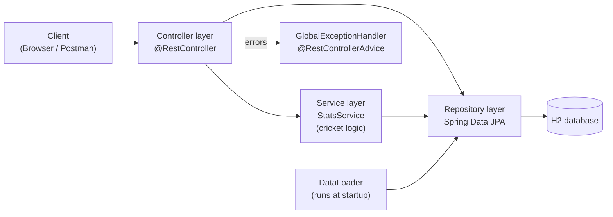
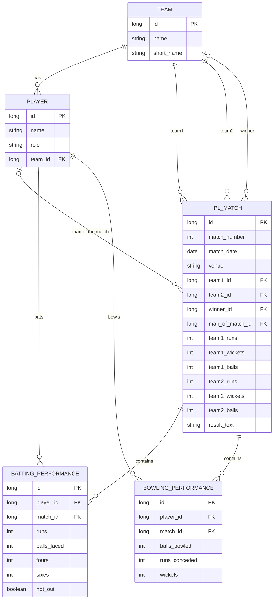

# CricStats: Design Document

## Problem statement
IPL fans and analysts want quick answers (who has the Orange Cap, what is a bowler's
economy, where does a team stand), but scorecards are scattered across matches and
manual calculation is slow and error-prone. CricStats stores the scorecard of each match
once and calculates every statistic from that single source of truth, exposing it
through a REST API.

## Layered architecture

- **Controller:** receives HTTP requests, validates input (`@Valid`), returns JSON and status codes.
- **Service:** holds the calculations (averages, strike rates, MVP, points table, net run rate).
- **Repository:** `JpaRepository` interfaces. JPA generates the SQL.
- **Exception handler:** turns exceptions into clean JSON errors.
- Spring injects each dependency through the constructor (dependency injection).

## ER diagram

## Key design decisions
- **Only raw scorecard data is stored.** Totals, averages, 50s and 100s are calculated, so
  nothing can get out of sync.
- **Overs are stored as balls** (3.4 overs = 22 balls) because cricket overs are not decimals.
- **Batting average = runs / dismissals.** A player never dismissed has an undefined average
  (null in leaderboards, HTTP 422 when requested directly).
- **Net run rate** counts a team that is all out as having faced its full 20 overs.
- **Points table:** 2 points per win, 1 per no result.
- **MVP formula:** 1 point per run, +1 per four, +2 per six, +10 per fifty, +25 per hundred,
  25 per wicket (constants at the top of `StatsService`).
- **Persistence:** H2 file database so data survives restarts; `DataLoader` fills it on first start.